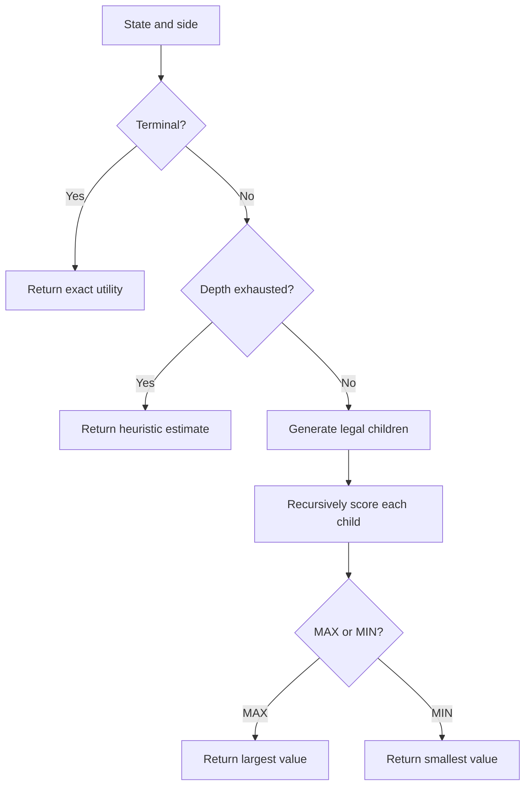
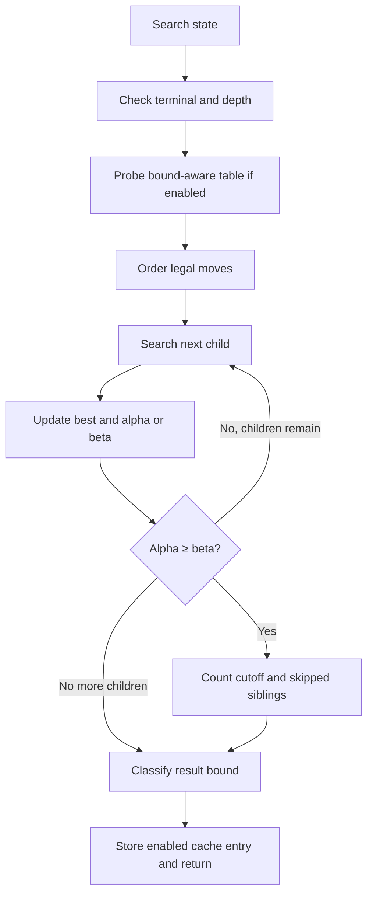

# Algorithms and measurement

## Minimax

O is MAX; X is MIN. Legal actions produce successor tuples. At terminal states the score is `+(100 - occupied_cells)` for O victory, its negative for X victory, and zero for draws. Scores depend on absolute board occupancy, not depth relative to a changing root. Thus cached scores remain stable. Every victory dominates heuristic estimates (clamped to ±50).

MAX selects the largest child value; MIN selects the smallest. Baseline recursively explores all remaining moves with row-major ordering, no pruning and no memoization. Worst-case tree complexity O(b^d), recursion space O(d) excluding immutable child allocations and bounded trace. Branching b declines as cells fill.

## Alpha-beta

Alpha is MAX's guaranteed lower bound; beta is MIN's guaranteed upper bound. Each search updates its corresponding bound. If alpha ≥ beta, the remaining siblings cannot improve the ancestor's decision, so exploration stops. Basic alpha-beta uses the same ordering as baseline. It preserves the exact root minimax value. Favorable ordering can greatly reduce traversal; worst case remains O(b^d).

Root candidates deliberately receive independent full windows. This returns trustworthy values for every alternative displayed in the dashboard. It can explore more nodes than a conventional root carrying alpha across candidates. Comparisons use this policy consistently.

## Ordering and transpositions

Optimized ordering: immediate wins; immediate blocks; own forks; opponent fork squares; center; corners; edges. These are priorities, not forced moves. Search still proves the game value. Fork prevention by ordering a square does not imply that the square solves every multi-threat situation.

A transposition key is `(canonical_board, side_to_move, remaining_depth)`. An entry contains score and EXACT, LOWER or UPPER flag. Store UPPER when value ≤ original alpha; LOWER when value ≥ original beta; otherwise EXACT. On lookup return EXACT directly; otherwise tighten bounds and return the bound only if the window closes. Never label a cutoff value exact indiscriminately. Each decision starts with a cold table. No heuristic depth-limited scores are cached by the experimental engine.

Symmetry enumerates all four rotations of the original and reflected square and selects the lexicographically smallest tuple. Only scores are cached. Root moves always use original board coordinates.

## Experimental mode

At the depth boundary use open-line weights (one mark = 1, two marks = 6), center weight 2, corners weight 1, and fork weight 3, from O's perspective. Clamp to ±50. Terminal evaluation always runs first. This heuristic is a handcrafted estimate, not a trained model. Iterative deepening repeats horizons 1..limit; it accumulates work, with the last completed horizon deciding the move. There is no time budget or interruption policy. Searching every remaining ply restores exact values.

## Counter definitions

- Nodes: every recursive call including cache hits, plus one root per iteration.
- Terminal evaluations: calls finding a terminal board before table lookup.
- Heuristic leaves: nonterminal calls evaluated at remaining depth zero.
- Cutoffs: alpha-beta loop stops, including when no sibling remains.
- Skipped child branches: count of immediate remaining siblings at those stops. Descendants are not estimated.
- Cache hits: lookup finds an entry, even if it only tightens the search window.
- Cache misses: lookup finds no entry on a nonterminal cache-eligible call.
- Stored keys: table size, not nodes or every distinct board visited.
- Maximum depth: deepest visited ply from the current root.
- Achieved depth: completed root horizon; 0 on a terminal board.
- Time: `perf_counter` duration of search, traces and alternatives; excludes GUI rendering and worker startup.

Trace: at most 100 records at plies 1–2, recording actual search returns, cache events and cutoff flags. A cutoff return may be a bound. Iterative mode shows the final iteration's trace. Unvisited siblings are counted, not fabricated as visited tree nodes.

## Algorithm flowcharts

Search-tree example: board `OO./XX./X..`, O to move. Placing O at row 1 column 3 immediately wins with +93 (seven occupied cells). Competing root moves are searched and scored independently. The actual recorded tree can be inspected in the GUI.
